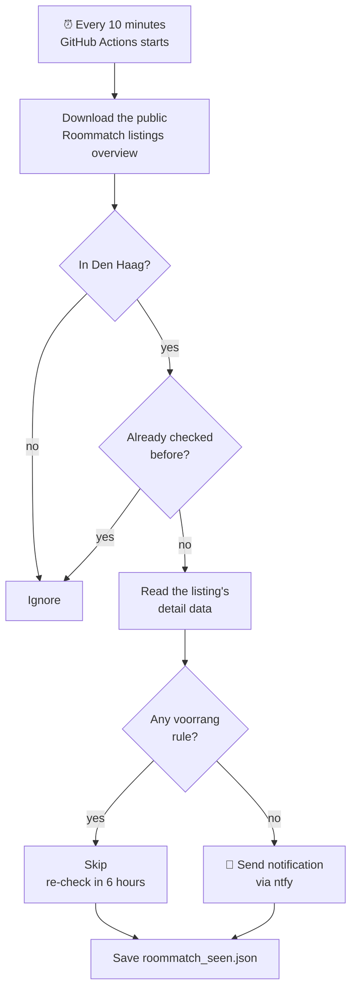

# 🏠 Roommatch watcher

Sends a push notification to my phone when a new room or studio in **Den Haag** appears on [Roommatch](https://www.roommatch.nl/aanbod/studentenwoningen) **without any voorrang (priority) rule**.

It runs for free on GitHub Actions every 10 minutes, so no computer has to stay on. It only *watches*: reacting to a listing is still done by hand on Roommatch.

---

## How it works



1. **Overview.** The script downloads Roommatch's public list of all current listings and keeps the ones in Den Haag.
2. **Details.** For every Den Haag listing it hasn't checked yet, it reads that listing's detail data: the same information the detail page shows, no login needed.
3. **Filter.** If the listing has *any* priority rule, it is skipped (see the table below).
4. **Notify.** Listings with no priority at all are sent to my phone with the address, rent, size, closing date and a link.
5. **Remember.** It saves which listings it has handled in `roommatch_seen.json` and commits that file back to this repository, so I never get the same listing twice.

Skipped listings are checked again every 6 hours, in case the priority is lifted later.

## What counts as voorrang

A listing is skipped if **any** of these apply:

| On the Roommatch page | Field in the data |
|---|---|
| "De voorrangsregeling voor eerstejaars studenten is van toepassing" | `sorteringBeleidsregels` (e.g. `studentenHaaglanden1`) |
| Priority for students from abroad | `sorteringBeleidsregels` (`studentUitBuitenland`) |
| Priority by age | `voorrangLeeftijdMin` / `voorrangLeeftijdMax` |
| Priority by household size | `voorrangHuishoudgrootteMin` / `Max` |
| Priority for families with children | `voorrangGezinnenKinderen` |
| Priority for local ties (kernbinding) | `voorrangKernbinding` |
| Priority for urgentie | `voorrangAlleUrgenties` |
| A priority group | `sorteergroep` |
| Any short info line, e.g. "Voorrang voor Sloop & Renovatieurgentie" or "Eerstejaars masterstudent gezocht" | `infoveldKort` |

> **Why the detail data?** The first-year rule doesn't appear in the overview at all, only on each listing's detail page. That's why every Den Haag listing is looked up individually.

## Files

| File | What it is |
|---|---|
| `roommatch_watcher.py` | The script. Python standard library only, nothing to install. |
| `.github/workflows/watch.yml` | The schedule: runs the script every 10 minutes and saves `roommatch_seen.json`. |
| `roommatch_seen.json` | The script's memory: listings already notified, and skipped ones with the time they were checked. Written automatically. |

## Notifications

Notifications go through [ntfy](https://ntfy.sh), a free push service. The ntfy app on my phone is subscribed to a private topic.

The topic name is stored as the repository secret **`NTFY_TOPIC`** (Settings → Secrets and variables → Actions), **not** in the code. Anyone who knows the topic could read the notifications, so it should stay out of this public repository.

To change it: create a new topic in the ntfy app, then update the `NTFY_TOPIC` secret with the new name.

## Settings

The script reads optional settings from environment variables. To use them, add an `env:` line to the **Check Roommatch** step in `.github/workflows/watch.yml`:

```yaml
      - name: Check Roommatch
        env:
          NTFY_TOPIC: ${{ secrets.NTFY_TOPIC }}
          MAX_TOTAL_RENT: "800"        # example: only listings up to €800 total rent
        run: python3 roommatch_watcher.py
```

| Setting | Default | What it does |
|---|---|---|
| `CITIES` | `Den Haag` | Cities to watch, comma-separated, e.g. `Den Haag,Delft` |
| `MAX_TOTAL_RENT` | `0` (off) | Ignore listings with a higher total rent |
| `ONLY_ZELFSTANDIG` | `false` | `true` = only self-contained homes (own kitchen and bathroom) |
| `SKIP_HOSPITEREN` | `false` | `true` = skip listings where current housemates pick the new tenant |
| `STRICT` | `true` | `true` = skip every listing with a short info line. `false` = only skip info lines with priority words |
| `RECHECK_HOURS` | `6` | How often skipped listings are checked again |

**Changing how often it runs:** edit the `cron` line in `watch.yml`. The times are in UTC; GitHub won't run schedules more often than every 5 minutes.

## Using it

- **See what it did:** open the **Actions** tab, click a run, then the **Check Roommatch** step. It lists every listing it checked and why it was skipped.
- **Run a check now:** Actions → **Roommatch watcher** → **Run workflow**.
- **Pause it:** Actions → **Roommatch watcher** → **⋯** → **Disable workflow**. Use **Enable workflow** to turn it back on.

### Run it on your own computer

```bash
python3 roommatch_watcher.py --dry-run   # show every Den Haag listing and why it's skipped
NTFY_TOPIC=your-topic python3 roommatch_watcher.py --test   # send a test notification
NTFY_TOPIC=your-topic python3 roommatch_watcher.py --loop   # keep checking every 10 minutes
```

Only run one copy at a time (this repository *or* your computer), otherwise every notification arrives twice.

## Troubleshooting

| Problem | What's going on |
|---|---|
| No notifications for a long time | Usually normal: almost every Den Haag listing has the first-year rule. Check the latest run log to see what was skipped. |
| Runs stopped completely | GitHub pauses schedules in public repositories after 60 days without activity. Go to Actions → **Enable workflow**. |
| Checks are late | GitHub sometimes delays scheduled runs by 5–30 minutes when it's busy. |
| Run fails with `403` | Roommatch is refusing requests from GitHub's servers. Run the script on your own computer or a small server instead. |
| A notification still had voorrang | Roommatch may have added a new kind of rule. Open the listing, then check the run log for what the script saw. |

## Good to know

- It uses only the public data that Roommatch's own website loads, and waits a second between detail requests to keep the load on the site low.
- It never logs in and doesn't react to listings for you. Reacting is still done on Roommatch with your ROOM.nl account.
- For personal use only.
