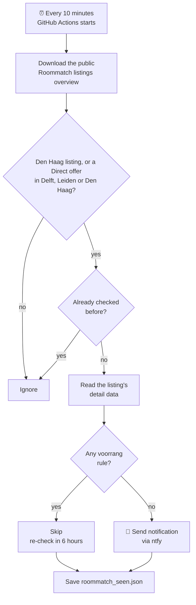

# 🏠 Roommatch watcher

Sends a push notification to my phone when a new listing appears on [Roommatch](https://www.roommatch.nl/aanbod/studentenwoningen) that is either:

- a room or studio in **Den Haag** **without any voorrang (priority) rule**, or
- a **Direct offer** in **Delft, Leiden or Den Haag** (also without a priority rule).

It runs for free on GitHub Actions every 10 minutes, so no computer has to stay on. It only *watches*: reacting to a listing is still done by hand on Roommatch.

---

## How it works



1. **Overview.** The script downloads Roommatch's public list of all current listings and keeps the ones it watches: everything in Den Haag, plus Direct offers in Delft, Leiden and Den Haag.
2. **Details.** For every watched listing it hasn't checked yet, it reads that listing's detail data: the same information the detail page shows, no login needed.
3. **Filter.** If the listing has *any* priority rule, it is skipped (see the table below).
4. **Notify.** Listings with no priority at all are sent to my phone with the address, rent, size, closing date and a link.
5. **Remember.** It saves which listings it has handled in `roommatch_seen.json` and commits that file back to this repository, so I never get the same listing twice.

Skipped listings are checked again every 6 hours, in case the priority is lifted later.

## What counts as voorrang

A listing is skipped if **any** of these apply:

| On the Roommatch page | Field in the data |
|---|---|
| "De voorrangsregeling voor eerstejaars studenten is van toepassing" | `sorteringBeleidsregels` (e.g. `studentenHaaglanden1`) |
| Priority for students from abroad | `sorteringBeleidsregels` (`studentUitBuitenland`) |
| Priority by age | `voorrangLeeftijdMin` / `voorrangLeeftijdMax` |
| Priority by household size | `voorrangHuishoudgrootteMin` / `Max` |
| Priority for families with children | `voorrangGezinnenKinderen` |
| Priority for local ties (kernbinding) | `voorrangKernbinding` |
| Priority for urgentie | `voorrangAlleUrgenties` |
| A priority group | `sorteergroep` |
| Any short info line, e.g. "Voorrang voor Sloop & Renovatieurgentie" or "Eerstejaars masterstudent gezocht" | `infoveldKort` |

> **Why the detail data?** The first-year rule doesn't appear in the overview at all, only on each listing's detail page. That's why every watched listing is looked up individually.

## Direct offers

On Roommatch, a **Direct offer** is a listing where the order is decided by when you react, not by how long you've been registered: reacting early matters. They're often temporary rooms that are available *per direct*. Because speed matters, the watcher reports them separately.

**What gets reported:** every new Direct offer in **Delft, Leiden or Den Haag** that has no priority rule.

| | Regular listings | Direct offers |
|---|---|---|
| Cities | Den Haag | Delft, Leiden, Den Haag |
| Order decided by | Inschrijfduur (how long you've been registered) | When you react |
| A note like "Deze kamer is tijdelijk beschikbaar t/m 31-01-27" | Skipped | **Reported** |
| A real priority rule (see the table above) | Skipped | Skipped |

For direct offers, an info line only counts as priority when it mentions priority words such as voorrang, urgentie, eerstejaars or gezocht.

**What the notification looks like:**

```
Direct offer: Lisztstraat 131 k1, Delft - EUR 543
Buitenhof
Onzelfstandig, 16 m2
Total rent: EUR 542.82
Type: Direct offer
Available: Per direct
Deze kamer is tijdelijk beschikbaar t/m 31-01-27
Closes: 2026-10-21 16:42:00
```

It comes with the room's photo and the **Reageer** and **Kaart** buttons (see [Notifications](#notifications)).

**In the data:** a Direct offer has model `reactiedatum`.

**Change or turn off:** set `DIRECT_OFFER_CITIES` (see [Settings](#settings)), for example `"Delft"` for Delft only, or `""` to stop direct-offer notifications.

## Files

| File | What it is |
|---|---|
| `roommatch_watcher.py` | The script. Python standard library only, nothing to install. |
| `.github/workflows/watch.yml` | The schedule: runs the script every 10 minutes and saves `roommatch_seen.json`, also after a failed run. |
| `roommatch_seen.json` | The script's memory: listings already notified, skipped ones with the time they were checked, and health info (failed checks in a row, last successful check). Written automatically. |

## Notifications

Notifications go through [ntfy](https://ntfy.sh), a free push service. The ntfy app on my phone is subscribed to a private topic.

The topic name is stored as the repository secret **`NTFY_TOPIC`** (Settings → Secrets and variables → Actions), **not** in the code. Anyone who knows the topic could read the notifications, so it should stay out of this public repository.

To change it: create a new topic in the ntfy app, then update the `NTFY_TOPIC` secret with the new name.

Every listing notification includes:

- **The room's photo**, the listing's first picture.
- **Reageer**: opens the listing on Roommatch, where the Reageer button is. Reacting itself still takes one tap there, because Roommatch only accepts reactions from its own page while you're logged in.
- **Kaart**: shows the location on Google Maps.
- Tapping the notification itself also opens the listing.

## Problem alerts

The watcher warns me when something goes wrong, so a quiet phone never secretly means a broken watcher.

| Situation | What I get |
|---|---|
| **3 checks in a row fail** (Roommatch unreachable or blocking, the site changed, an error) | ⚠️ "Roommatch watcher has a problem", with the error and the time of the last successful check. Repeated at most every 12 hours while it stays broken. |
| **It works again** after an alert | ✅ "Roommatch watcher works again" |
| **A run fails** | The run gets a red cross in the Actions tab, and GitHub sends me its usual failure email. |

**Built-in safety:** if a listing's detail data no longer contains the priority information (for example because Roommatch changed its site), the listing is **not** sent. The watcher won't guess "no priority". It tries again on the next run, and if every listing fails, that counts as a failed check.

**Staying active:** the memory file is updated at least once a day, so the repository always has recent activity. That stops GitHub from pausing the schedule after 60 quiet days.

One thing it can't report: if GitHub doesn't start runs at all, there's no run to send an alert. In that case GitHub's own emails, or a look at the Actions tab, will show it.

## Settings

The script reads optional settings from environment variables. To use them, add an `env:` line to the **Check Roommatch** step in `.github/workflows/watch.yml`:

```yaml
      - name: Check Roommatch
        env:
          NTFY_TOPIC: ${{ secrets.NTFY_TOPIC }}
          MAX_TOTAL_RENT: "800"        # example: only listings up to €800 total rent
        run: python3 roommatch_watcher.py
```

| Setting | Default | What it does |
|---|---|---|
| `CITIES` | `Den Haag` | Cities to watch for listings without voorrang, comma-separated, e.g. `Den Haag,Delft` |
| `DIRECT_OFFER_CITIES` | `Delft,Leiden,Den Haag` | Cities to watch for Direct offers. Set to `""` to turn this off |
| `MAX_TOTAL_RENT` | `0` (off) | Ignore listings with a higher total rent |
| `ONLY_ZELFSTANDIG` | `false` | `true` = only self-contained homes (own kitchen and bathroom) |
| `SKIP_HOSPITEREN` | `false` | `true` = skip listings where current housemates pick the new tenant |
| `STRICT` | `true` | `true` = skip every listing with a short info line (except Direct offers, see above). `false` = only skip info lines with priority words |
| `RECHECK_HOURS` | `6` | How often skipped listings are checked again |
| `ALERT_AFTER_FAILURES` | `3` | Failed checks in a row before a problem alert |
| `ALERT_REPEAT_HOURS` | `12` | How often the problem alert repeats while it stays broken |

**Changing how often it runs:** edit the `cron` line in `watch.yml`. The times are in UTC; GitHub won't run schedules more often than every 5 minutes.

## Using it

- **See what it did:** open the **Actions** tab, click a run, then the **Check Roommatch** step. It lists every listing it checked and why it was skipped.
- **Run a check now:** Actions → **Roommatch watcher** → **Run workflow**.
- **Send a test notification:** Actions → **Roommatch watcher** → **Run workflow** → tick **Only send a test notification to my phone** → **Run workflow**.
- **Pause it:** Actions → **Roommatch watcher** → **⋯** → **Disable workflow**. Use **Enable workflow** to turn it back on.

### Run it on your own computer

```bash
python3 roommatch_watcher.py --dry-run   # show every watched listing and why it's skipped
NTFY_TOPIC=your-topic python3 roommatch_watcher.py --test   # send a test notification
NTFY_TOPIC=your-topic python3 roommatch_watcher.py --loop   # keep checking every 10 minutes
```

Only run one copy at a time (this repository *or* your computer), otherwise every notification arrives twice.

## Troubleshooting

| Problem | What's going on |
|---|---|
| No notifications for a long time | Usually normal: almost every regular Den Haag listing has the first-year rule, and Direct offers don't appear every day. Check the latest run log to see what was skipped. |
| ⚠️ "Roommatch watcher has a problem" | Open the Actions tab and look at the latest red run. A `403` means Roommatch is blocking GitHub; anything else, check the error in the run log. |
| Runs stopped completely | GitHub pauses schedules in public repositories after 60 days without activity (the daily memory update should prevent this). Go to Actions → **Enable workflow**. |
| Checks are late | GitHub sometimes delays scheduled runs by 5–30 minutes when it's busy. |
| Run fails with `403` | Roommatch is refusing requests from GitHub's servers. Run the script on your own computer or a small server instead. |
| A notification still had voorrang | Roommatch may have added a new kind of rule. Open the listing, then check the run log for what the script saw. |

## Good to know

- It uses only the public data that Roommatch's own website loads, and waits a second between detail requests to keep the load on the site low.
- It never logs in and doesn't react to listings for you. Reacting is still done on Roommatch with your ROOM.nl account.
- For personal use only.
